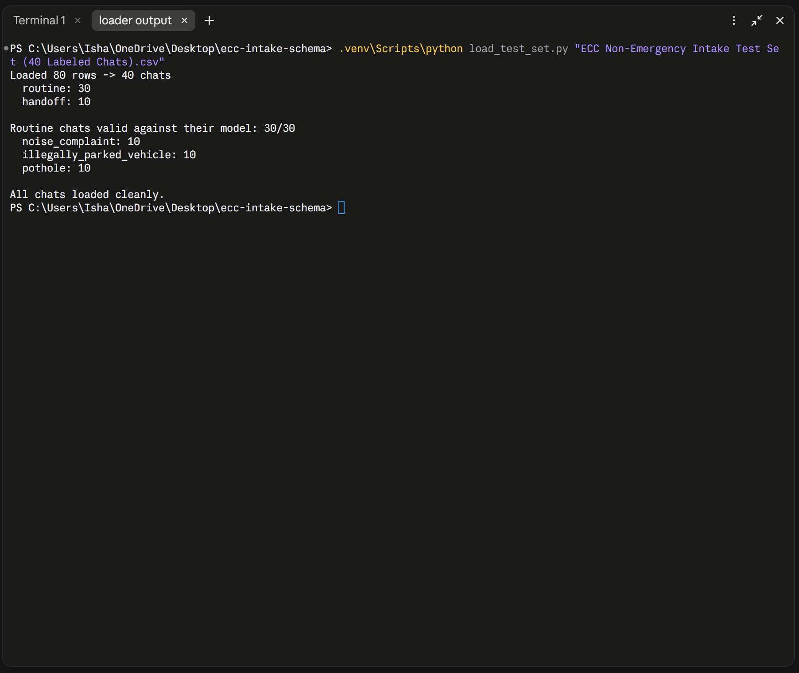
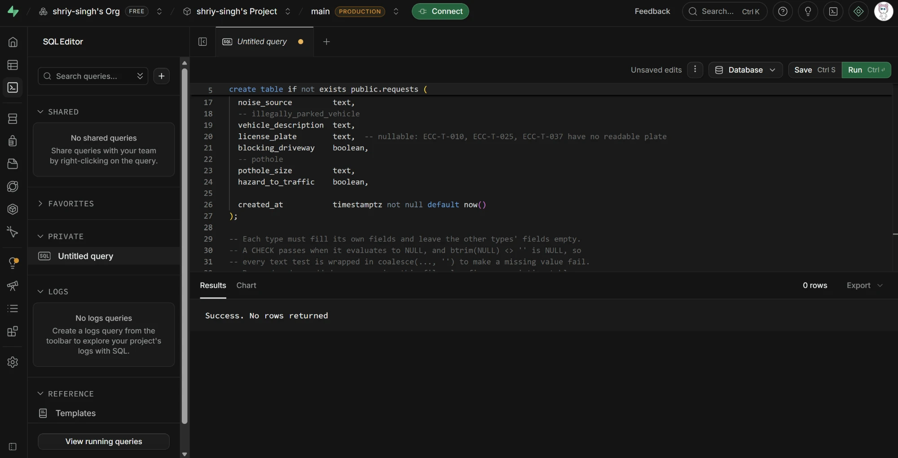
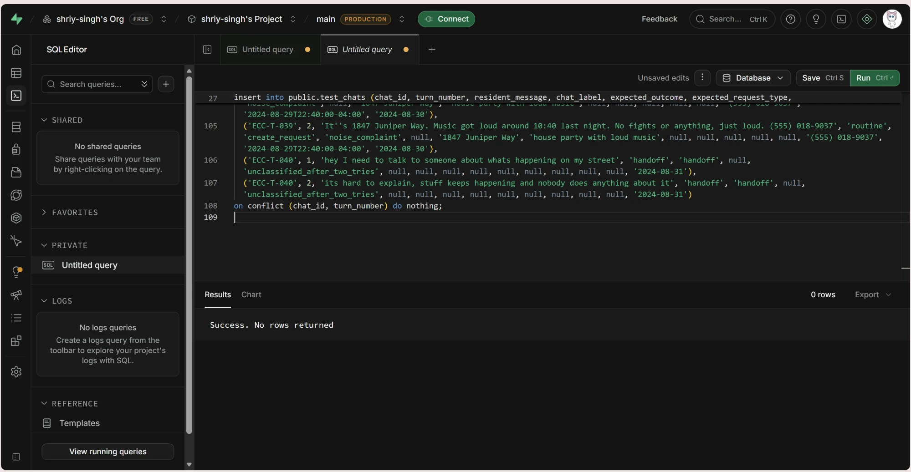

# ECC Intake Schema

Request schema and test-set loader for the ECC non-emergency chat agent. The
agent saves three kinds of routine report (noise complaint, illegally parked
vehicle, pothole) and hands everything else — any sign of danger, or a chat it
can't understand — to a dispatcher.

## Loader result

The loader groups the 40-chat test set by `chat_id`, counts routine vs handoff
chats, and validates every routine chat's expected fields against its model.

```
Loaded 80 rows -> 40 chats
  routine: 30
  handoff: 10

Routine chats valid against their model: 30/30
  noise_complaint: 10
  illegally_parked_vehicle: 10
  pothole: 10

Failures: 0
```

- Full terminal output: [docs/loader_output.txt](docs/loader_output.txt)
- Screenshot: [docs/loader_output.png](docs/loader_output.png)



## Models

[`src/ecc_intake_schema/models.py`](src/ecc_intake_schema/models.py) — one
Pydantic model per request type. Every field is required. A field may accept
an empty value only when a correct routine chat in the test set leaves it blank,
with a comment naming those chats; a test enforces this against the data.

| Model | Fields |
|---|---|
| `NoiseComplaint` | `location`, `noise_source`, `incident_observed_at`, `callback_phone` |
| `IllegallyParkedVehicle` | `location`, `vehicle_description`, `license_plate`*, `blocking_driveway`, `incident_observed_at`, `callback_phone` |
| `Pothole` | `location`, `pothole_size`, `hazard_to_traffic`, `incident_observed_at`, `callback_phone` |

\* `license_plate` must be supplied but may be `null`: ECC-T-010, ECC-T-025 and
ECC-T-037 are complete routine chats where the resident couldn't read the plate.

The test set is dispatch's ground truth: if a correct sample fails validation,
the model is fixed, never the data.

## Run it

```bash
python -m venv .venv
.venv\Scripts\python -m pip install -r requirements.txt
.venv\Scripts\python load_test_set.py
.venv\Scripts\python -m pytest -q
```

`load_test_set.py` takes an optional CSV path; by default it reads
`data/palantir_ecc_intake_test_set_40_chats.csv`. It always prints the failure
count, lists every failing chat and field, and exits non-zero if there are any.

## Supabase

Run these in the Supabase SQL Editor:

- [`sql/schema.sql`](sql/schema.sql) — `requests` (saved routine reports) and
  `handoffs` (escalated chats). Safe to re-run; re-running also updates the
  `requests` check constraint on an existing table.
- [`sql/test_chats.sql`](sql/test_chats.sql) — the 40-chat test set as a
  `test_chats` table, 80 rows. Generated by
  [`scripts/make_test_chats_sql.py`](scripts/make_test_chats_sql.py); blank CSV
  cells become `NULL`.

Row Level Security is enabled on all tables; the FastAPI backend writes with
the service-role key.

### The database enforces the same rules as the models — tested, not assumed

Every required-field rule exists twice: once in the Pydantic models and once in
the `requests` table's constraints. [`tests/test_schema_sql.py`](tests/test_schema_sql.py)
runs both SQL files against a real local Postgres 16 (via `pgserver`) and, for
every field of every model, sets it to null and checks that the model and the
database give the same answer. It also inserts all 30 routine reports and 10
handoffs, and confirms `test_chats` loads 80 rows (30 routine, 10 handoff chats).

These tests caught a real bug that a SQL parser had passed: Postgres lets a
CHECK pass when it evaluates to NULL, and `btrim(NULL) <> ''` is NULL, so a
noise complaint with no `noise_source` (likewise `vehicle_description`,
`pothole_size`) saved cleanly. The checks now use `coalesce(btrim(x), '') <> ''`.

### Run in the Supabase project

Both files were run in the project's SQL Editor (`main`, production) and
completed with "Success. No rows returned".

`sql/schema.sql` — creates `requests` (with the coalesce-fixed check) and `handoffs`:



`sql/test_chats.sql` — creates `test_chats` and inserts the 80 test-set rows:


